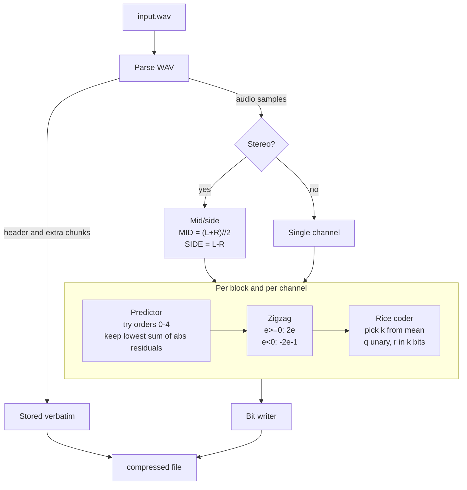
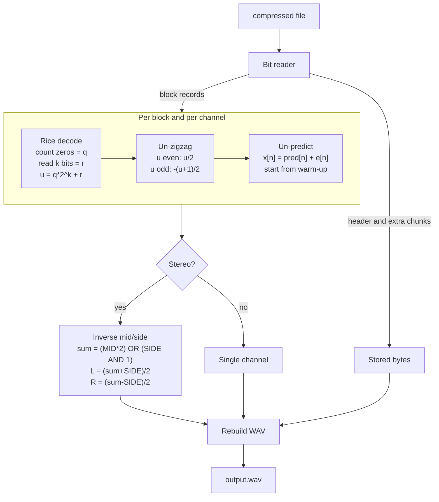
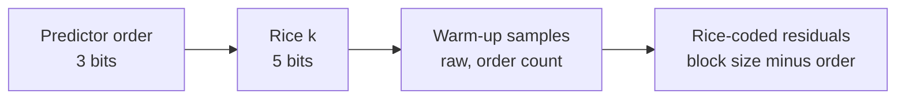
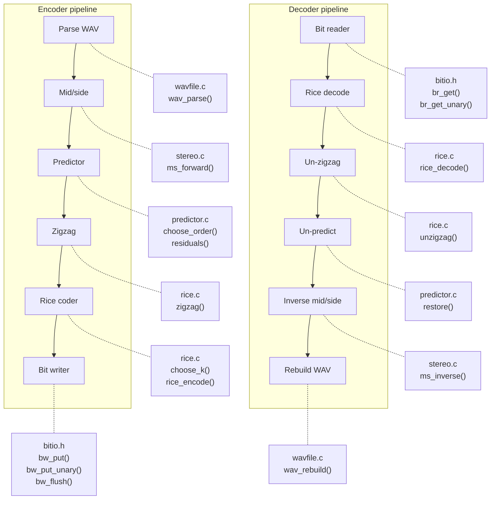
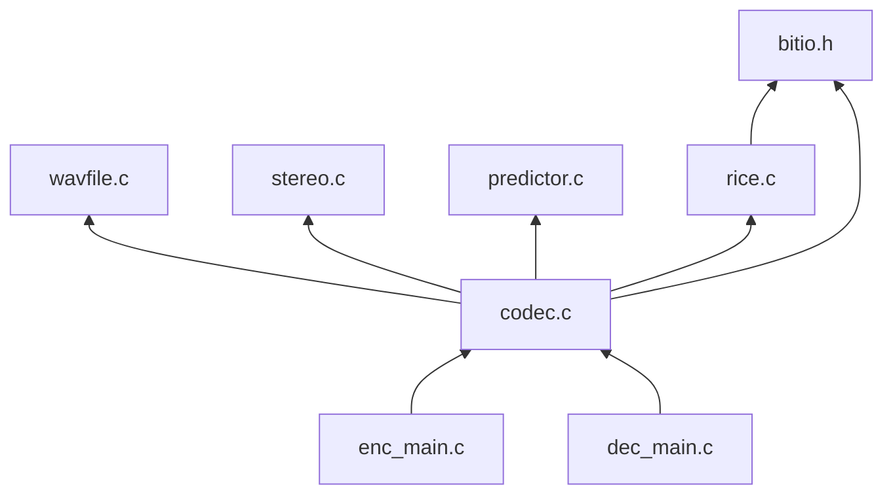
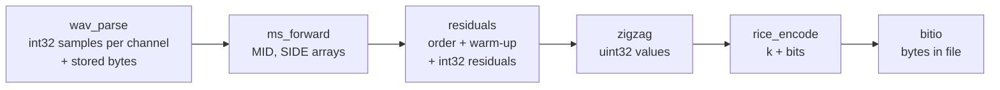

# Lossless audio codec: design

C implementation. Commands required by the assignment:

```
wav_lossless_enc [flags] input.wav compressed_file
wav_lossless_dec compressed_file output.wav
```

The decoded file must be byte-identical to the original WAV.

## Scope

| Item | Decision |
|---|---|
| Language | C |
| Sample widths | 8, 16, 24-bit (held as `int32` internally) |
| Channels | mono, stereo (more than 2 channels or 32-bit: rejected with an error) |
| Block size | configurable by CLI flag (default 4096 samples) |
| Exact output | non-audio WAV bytes (header, extra chunks) stored verbatim |
| Predictor | fixed polynomial, orders 0 to 4, best per block |
| Entropy coder | Rice coding, `k` chosen per block |
| Stretch goal | adaptive LPC (same architecture, swaps the predictor) |

## Encoder flow



## Decoder flow



## Compressed file layout


Each block record, per channel:




## Predictors

| Order | Prediction `pred[n]` | Warm-up samples |
|---|---|---|
| 0 | `0` | 0 |
| 1 | `x[n-1]` | 1 |
| 2 | `2x[n-1] - x[n-2]` | 2 |
| 3 | `3x[n-1] - 3x[n-2] + x[n-3]` | 3 |
| 4 | `4x[n-1] - 6x[n-2] + 4x[n-3] - x[n-4]` | 4 |

Residual: `e[n] = x[n] - pred[n]`. Selection cost: sum of `|e[n]|` over the block.

## Rice coding

For a non-negative value `u` and parameter `k`:

| Symbol | Meaning |
|---|---|
| `q = u >> k` | quotient, written in unary (`q` zeros then a `1`) |
| `r = u & (2^k - 1)` | remainder, written in `k` bits |
| cost | `q + 1 + k` bits |

Choosing `k`: roughly `log2(mean(u))` per block. Too small gives long unary runs, too large wastes remainder bits.

### Worked example (k = 2)

| u | q | r | code |
|---|---|---|---|
| 3 | 0 | 3 | `1 11` |
| 6 | 1 | 2 | `01 10` |
| 9 | 2 | 1 | `001 01` |

## Worked example: mid/side

| n | 0 | 1 | 2 | 3 |
|---|---|---|---|---|
| L | 100 | 102 | 105 | 103 |
| R | 98 | 101 | 104 | 102 |
| MID | 99 | 101 | 104 | 102 |
| SIDE | 2 | 1 | 1 | 1 |

SIDE is nearly constant, so its residuals are close to zero and cost very few bits.

## Code modules

Which source file provides which stage of the codec.



### Module responsibilities

| File | Provides | Used by |
|---|---|---|
| `bitio.h` | Buffered MSB-first bit writer and reader (`bw_put`, `bw_put_unary`, `bw_flush`, `br_get`, `br_get_unary`), fixed 64 KiB buffers | `rice.c`, `codec.c` |
| `wavfile.c` | `wav_parse()` splits a WAV into stored non-audio bytes plus `int32` samples. `wav_rebuild()` writes the byte-identical WAV back. Handles 8, 16, 24-bit | `codec.c` |
| `stereo.c` | `ms_forward()` and `ms_inverse()`: the exact mid/side transform | `codec.c` |
| `predictor.c` | Fixed predictors of order 0 to 4, `choose_order()` per block, `residuals()` on encode, `restore()` on decode | `codec.c` |
| `rice.c` | `zigzag()` / `unzigzag()`, `choose_k()`, `rice_encode()` / `rice_decode()` | `codec.c` |
| `codec.c` | `encode_block()` / `decode_block()` chain the stages for one block. Writes and reads the global header | `enc_main.c`, `dec_main.c` |
| `enc_main.c` | `wav_lossless_enc` CLI: flags (block size), file handling | none |
| `dec_main.c` | `wav_lossless_dec` CLI: file handling | none |

### Dependencies



### Data passed between modules

