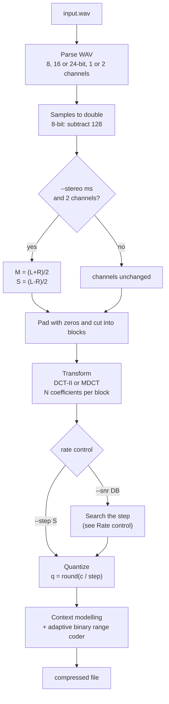
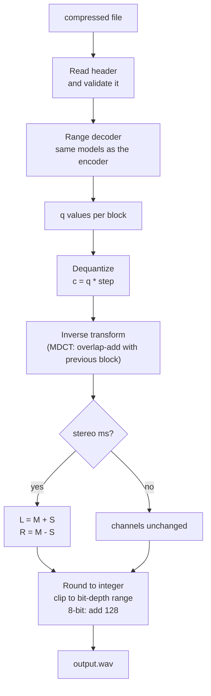
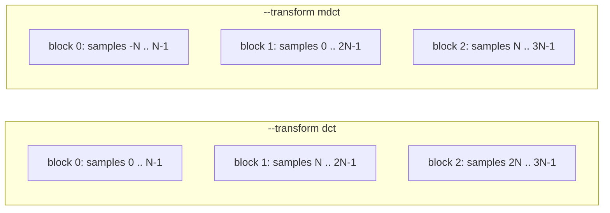
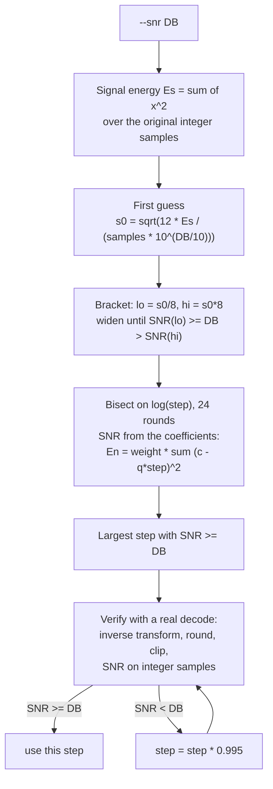
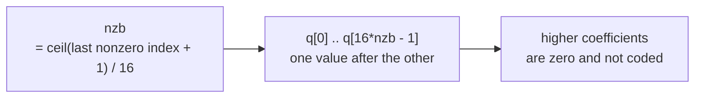
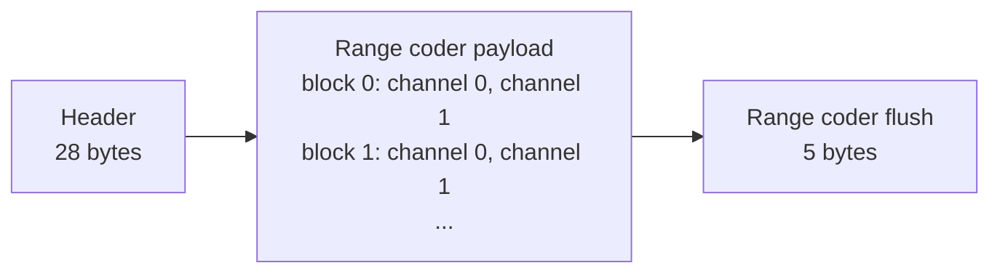
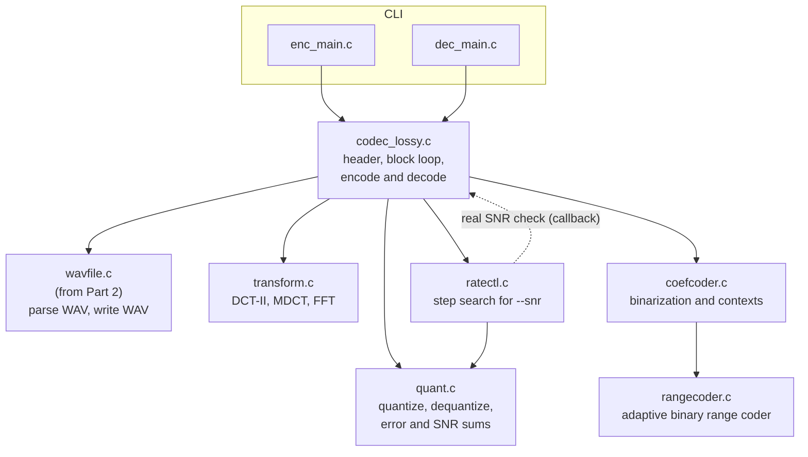

# Lossy audio codec (DCT based)

C implementation. Commands required by the assignment:

```
wav_lossy_enc [options] input.wav compressed_file
wav_lossy_dec compressed_file output.wav
```

The decoder needs no options: everything it needs is in the file header.
The decoded WAV has the same sample rate, channels and bit depth as the
original, but it is **not** byte-identical (this is a lossy codec). It always
has a plain 44-byte header; extra chunks of the original are not kept.

The goal is the best rate-distortion trade-off, where distortion is measured
as SNR. Because the metric is plain SNR (mean squared error), the design does
not use any psychoacoustic model.

## Options (encoder)

| Option | Values | Default | Meaning |
|---|---|---|---|
| `-b N` | power of two, 64 to 8192 | 2048 | transform size: N coefficients per block |
| `--transform` | `dct`, `mdct` | `mdct` | plain block DCT-II, or MDCT with 50% overlap and sine window |
| `--stereo` | `lr`, `ms` | `ms` | code left/right, or mid/side (ignored for mono) |
| `--step S` | real number > 0 | | fixed quantization step |
| `--snr DB` | real number > 0 | 30 | target SNR in dB; the encoder finds the largest step that reaches it |
| `-v` | | off | print step, achieved SNR, bits per sample, kbps |

`--step` and `--snr` exclude each other. With neither, `--snr 30` is used.

There is one more option, left out of `--help`: `--round R` (0.3 to 0.5, default
0.5), the rounding offset of the quantizer. It is used only by the encoder and is
not stored, so the decoder does not need it (see Experiments).

## Encoder flow



## Decoder flow



## Plain DCT versus MDCT

Both options use the same code after the transform. Only blocking, windowing
and the transform itself change, and the choice is stored in the header.



| | `dct` | `mdct` |
|---|---|---|
| Input per block | N new samples | 2N samples (N new, N shared with previous block), multiplied by the sine window |
| Output per block | N coefficients | N coefficients |
| Blocks for `F` frames | `ceil(F/N)` | `ceil(F/N) + 1` |
| Padding | zeros after the end | N zeros before the start and zeros after the end |
| Block edges | each block quantized on its own, error jumps at the edges | overlap-add smooths the edges (TDAC) |
| Cost | none | one extra block, slightly more work |

Definitions, both with orthonormal scaling:

- **DCT-II:** `X[k] = sqrt(2/N) * c_k * sum_n x[n] cos(pi/N * (n + 1/2) * k)`, with `c_0 = 1/sqrt(2)` and `c_k = 1` otherwise. The inverse is DCT-III.
- **MDCT:** `X[k] = sqrt(2/N) * sum_{n=0}^{2N-1} w[n] x[n] cos(pi/N * (n + 1/2 + N/2) * (k + 1/2))`, with the sine window `w[n] = sin(pi * (n + 1/2) / (2N))`. Inverse: the same cosines times `w[n]`, then overlap-add of the two halves.

Because both are orthonormal, **the squared error of the coefficients equals the
squared error of the samples** (Parseval). This is what makes one global step
optimal for SNR and makes the rate control search cheap.

Speed: direct formulas cost N operations per sample. The code uses an FFT
(radix-2, so N must be a power of two): DCT-II through an N-point complex
FFT, and the MDCT through a DCT-IV computed with an N/2-point complex FFT after
folding the 2N input samples to N. The direct versions stay in the code as the
reference for the tests.

## Stereo

`ms`: `M = (L+R)/2`, `S = (L-R)/2`, so `L = M + S`, `R = M - S`.
An error `eM` in M and `eS` in S gives errors `eM+eS` and `eM-eS` in L and R,
so the total squared error is `2*(eM^2 + eS^2)`. M and S get the same weight
(2), and one common step is still the right choice. The rate control uses
this weight when it computes the error from coefficients.

## Quantization

`q = sign(c) * floor(|c| / step + R)` with `R = 0.5` by default (plain rounding,
no dead zone) and `c' = q * step`. `R` is the hidden `--round` option; the
decoder only multiplies by the step, so it does not depend on `R`. One step for all coefficients, both channels and all blocks.
The step is stored as a 32-bit float; the encoder rounds it to that float
first, so encoder and decoder use the same value.

## Rate control



- **Why search on coefficients:** no inverse transform is needed inside the loop, each round is one pass of quantize and sum. The estimate is valid because of Parseval.
- **Why verify afterwards:** the final output is rounded to integers and clipped, which the coefficient domain does not see. The padded zeros are also counted as signal positions in the coefficient domain. The verification measures the real SNR on the real output, and the step is reduced slightly until the target is met (at most 20 times).
- **Limits:** the step is limited to `[max(0.01, 2*sqrt(2N)*2^(bits-1) / 2^30), 2^bits]`. The second lower bound guarantees `|q| <= 2^30` for any input, so every value fits the coefficient coder; it only matters for 24-bit input (step >= 1 at N = 2048). A `--step` below it is raised to it, with a warning. If even the smallest step cannot reach the target (for example, a target above what integer rounding allows), the encoder uses the smallest step and prints a warning with the SNR it got.
- **Silent input:** if `Es = 0`, SNR is undefined and the step is set to 1.
- **SNR definition:** `10*log10(sum x^2 / sum (x - y)^2)` over all channels and samples of the original `x` and decoded `y`, as integers (8-bit samples centered on 0).

## Entropy coding

The quantized values are mostly zeros, with rare large values at low
frequencies. An adaptive binary range coder (LZMA style: 32-bit range,
11-bit probabilities, adaptation shift 5, carry handled with a cache byte)
codes them with learned probabilities.

### What is coded per block and channel



- `nzb = ceil((last nonzero index + 1) / 16)`, 0 for an all-zero block, is coded with an adaptive bit tree of `log2(N/16) + 1` bits, one tree per channel. It saves coding the long run of zeros at high frequencies.
- Each coefficient is binarized as follows:

| Step | Bins | Model |
|---|---|---|
| 1 | `q == 0 ?` | `Z[channel][band][nctx]` |
| 2 | sign (only if nonzero) | no model, fixed probability 1/2 |
| 3 | `|q| > 1 ?`, `|q| > 2 ?`, ... up to `|q| > 14` (unary) | `U[channel][nctx][i]` |
| 4 | if `|q| >= 15`: `|q| - 15` as Exp-Golomb, order 0 | prefix bits: adaptive, one model per position `EG[channel][i]`; suffix bits: fixed 1/2 |

### Contexts

- `band = min(floor(log2(k + 1)), 11)`: 12 frequency classes, narrow at low frequencies where the statistics change fastest.
- `nctx`: from the magnitudes already known, with `p` the previous block of the same channel (zeros for the first block):
  `m = 2|q[k-1]| + |q[k-2]| + |p[k-1]| + 2|p[k]| + |p[k+1]|`.
  Neighbours outside the block count as 0.
  Mapped to 8 classes: `0`, `1`, `2`, `3-4`, `5-6`, `7-9`, `10-14`, `15+`.
- Each channel has its own set of models, because M and S have different statistics.
- The decoder computes the same contexts from the values it already decoded, so no side information is sent.

The weights in `m`, the class limits and the adaptation shift are starting
values. They are compared experimentally with compile-time variants (see
Build variants).

## File format

All numbers are little-endian.



| Offset | Size | Field |
|---|---|---|
| 0 | 4 | magic `ICD1` |
| 4 | 1 | channels (1 or 2) |
| 5 | 1 | bits per sample (8, 16, 24) |
| 6 | 1 | transform (0 = dct, 1 = mdct) |
| 7 | 1 | stereo (0 = lr, 1 = ms) |
| 8 | 4 | sample rate |
| 12 | 8 | number of frames |
| 20 | 4 | N (block size) |
| 24 | 4 | step (float32) |

The decoder rejects a file if the magic is wrong, channels or bits are not
supported, N is not a power of two in `[64, 8192]`, the step is not a finite
positive number, or `frames * channels` is above 2^31. A truncated payload
is detected by the range decoder (reading past the end sets an error flag);
bytes left over after the last block are also an error, because the decoder
reads exactly as many bytes as the encoder wrote. On any error the partial
output file is removed.

## Code modules



| File | Responsibility |
|---|---|
| `enc_main.c`, `dec_main.c` | command line parsing only |
| `codec_lossy.c` | header read/write and validation, padding and block layout, stereo, calls everything else |
| `transform.c` | FFT, DCT-II and inverse, MDCT and inverse, sine window; direct O(N^2) reference versions |
| `quant.c` | `quantize`, `dequantize`, sum of squared quantization error with channel weights |
| `ratectl.c` | the search and verification described above; the real decode for the verification is a callback into `codec_lossy.c`, so it runs exactly the decoder's synthesis code |
| `coefcoder.c` | `nzb`, binarization, contexts, model arrays; the only file that knows the coefficient statistics |
| `rangecoder.c` | encode/decode one bit with a probability model, bypass bits, flush; knows nothing about audio |
| `wavfile.c` | reused from Part 2 (`wav_parse`, `wav_deinterleave` on one block at a time, `wav_rebuild` to write each block); `wav_make_header` (added) builds the 44-byte output header |

Encoder and decoder call `coefcoder.c` through the same context function, so
they cannot drift apart.

## Memory and speed

| Mode | What is held in memory |
|---|---|
| `--step S` | the input file, plus one block of coefficients per channel. The blocks are transformed, quantized and coded one after the other. |
| `--snr DB` | the input file, plus all coefficients of the file as `float32` (4 bytes per sample), because the step search needs them several times. |
| decoder | the compressed file, plus one block per channel; output samples are written as they are produced. |

Transforms are computed in `double` per block. Stored coefficients are
`float32`, which is far more precise than the quantization step for any
useful SNR.

For example, a 16-bit stereo file of 53 MB has about 26.5 million samples:
`--snr` needs roughly 53 MB (input) + 106 MB (coefficients), while `--step`
needs roughly 53 MB.

## Tests

| Test | Checks |
|---|---|
| `test_transform` | FFT-based DCT-II and MDCT equal the direct O(N^2) versions on random blocks (difference below 1e-9); forward then inverse gives back the signal (perfect reconstruction, including the first and last block) |
| `test_rangecoder` | random bits with random fixed probabilities round-trip; adaptive models round-trip; reading past the end sets the error flag |
| `test_coefcoder` | random quantized blocks (all zero, mostly zero, large values, escape values) round-trip through the encoder and decoder |
| `test_lossy.py` | end to end: sine, noise, silence, mono/stereo, 8/16/24-bit, tiny files (0, 1, N-1, N, N+1 frames), every transform and stereo mode; the decoder output has the right length and format; with `--snr X` the measured SNR is at least X; damaged and truncated files are rejected without crashing |

All C tests also run with the sanitizer build.

## Benchmark against MP3 and AAC

`bench_lossy.sh` and `snr_tool.py` (standard library only):

1. For each WAV file, run our encoder for several targets (for example 20, 30, 40, 50 dB) with both transforms, and with `lr` and `ms`.
2. Run `ffmpeg` (libmp3lame and the native AAC encoder) at several bitrates (64 to 320 kbps), then decode back to WAV.
3. `snr_tool.py` computes the SNR of every result against the original. MP3 and AAC add a delay at the start, so it first finds the lag between 0 and 4096 samples that maximizes the correlation, trims it, and only then computes the SNR.
4. For every run it records size, bitrate (kbps), SNR, compression time, decompression time and peak memory (GNU time, as in `bench.sh`).
5. Output is a CSV that gives one rate-distortion curve per codec: SNR on one axis, kbps on the other.

The fair comparison is at equal SNR (or equal kbps), read off the curves.
MP3/AAC are built for perceptual quality, not for SNR, so a lower SNR at the
same bitrate is expected from them.

## Build variants

Two experiments change the decoder as well as the encoder, because both sides
must use the same contexts and the same adaptation speed. The header has no
field for them on purpose, so they are fixed when the program is compiled:

| Macro | Values | Default | Meaning |
|---|---|---|---|
| `CTX_MODE` | 0 none, 1 band only, 2 neighbours only, 3 both | 3 | which context information selects the model |
| `PROB_SHIFT` | 4, 5, 6 | 5 | adaptation speed of the probability models |

- `make` builds the default pair (`wav_lossy_enc`, `wav_lossy_dec`).
- `make variants` builds one pair per combination into `build/ctx<M>_shift<S>/`. The macros are resolved by the compiler, so the final programs have no run-time branches in the coefficient loop and no speed cost.
- The decoder cannot tell which variant a file was made with. A file decoded with the wrong variant gives wrong audio, not an error. To prevent this, the benchmark always takes the encoder and the decoder from the same `build/` folder, and `-v` prints the compiled-in values.
- Only the default pair is shipped. The variants exist for the report.

## Experiments for the report

Each is a controlled change with everything else fixed, measured as kbps at
equal SNR:

| # | Experiment | How it is switched |
|---|---|---|
| 1 | `dct` versus `mdct` | `--transform` (stored in the header) |
| 2 | Block size N from 256 to 8192 | `-b` (stored in the header) |
| 3 | `lr` versus `ms` | `--stereo` (stored in the header) |
| 4 | Context design: none, band only, neighbours only, both | `CTX_MODE`, compile time |
| 5 | Adaptation shift of the probability models: 4, 5, 6 | `PROB_SHIFT`, compile time |
| 6 | Rounding offset in the quantizer: 0.5 versus smaller values | hidden `--round`, run time, encoder only |
| 7 | Speed: FFT-based versus direct transform | direct versions in `transform.c`, timed by the test program |
